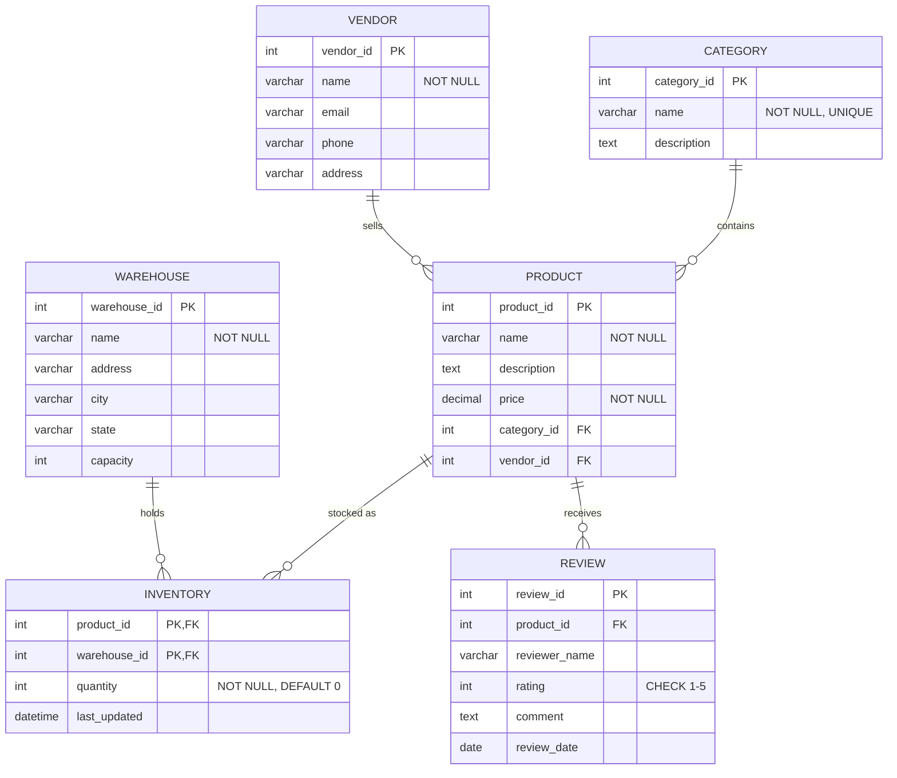

# E-Commerce Database Schema

## ER Diagram

## Tables

| Table | Purpose |
|---|---|
| **Category** | Product categories (e.g. Electronics, Books) |
| **Vendor** | Sellers who list products |
| **Product** | Product name, description, price; links to its category and vendor |
| **Warehouse** | Storage locations |
| **Inventory** | Quantity of each product in each warehouse (junction table) |
| **Review** | Customer ratings (1–5) and comments for products |

## Relationships

- **Category → Product** (1:N): each product belongs to one category.
- **Vendor → Product** (1:N): each product is sold by one vendor.
- **Product ↔ Warehouse** (M:N): resolved through **Inventory**, which stores the quantity per warehouse.
- **Product → Review** (1:N): a product can have many reviews.

## Derived Values

- **Average rating** = `AVG(Review.rating)` per product (computed, not stored).
- **Current availability** = `SUM(Inventory.quantity)` per product; "In Stock" if > 0.
